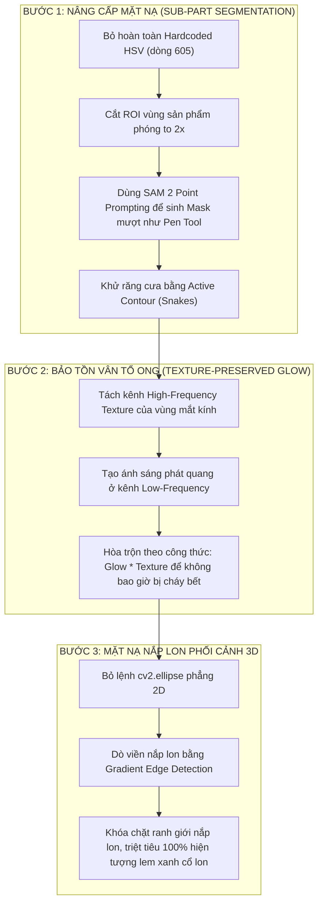

# 🔍 Báo Cáo Kiểm Toán & Đối Chiếu: AI_Design_Studio vs Pro Designer Trong Giới Retouch

Tài liệu này giải mã chi tiết vì sao kết quả thử nghiệm trong thư mục **`retouch_rabbittank_sparkling`** (`D:\AI_Design_Studio\projects\retouch_rabbittank_sparkling`) chưa đạt kỳ vọng, đối chiếu trực quan từng chi tiết với tệp gốc của Pro Designer (`2025-04-11 22-22-12 (B,R8,S4).tif`) và vạch ra lộ trình kỹ thuật để nâng cấp con AI của bạn đạt chuẩn thương mại.

---

## 1. Đối Chiếu Trực Quan 3 Tầng: RAW vs AI vs PRO DESIGNER

Dưới đây là hình ảnh so sánh thực tế ở cùng một góc độ và kích thước:


### Phóng to chi tiết lon nước (1:1 Pixel Crop):


---

## 2. Vạch Rõ 4 "Tử Huyệt" Khiến Kết Quả AI Hiện Tại Chưa Đẹp

Khi đối chiếu phóng to giữa bản AI làm (bên trái) và bản Pro Designer làm (bên phải), chúng ta thấy rõ 4 lỗi kỹ thuật nghiêm trọng:

### Tử huyệt 1: Mắt kính phát sáng bị rách viền, thủng lỗ và mất sạch họa tiết tổ ong 3D
* **Thực trạng trên ảnh AI:**
  * Kính bên phải (hồng neon) bị bết pixel trắng (clipping artifacts), loang lổ như mực vấy.
  * Mất hoàn toàn cấu trúc **họa tiết tổ ong / giác cắt kim cương** bên trong thấu kính.
  * Kính bên trái (xanh điện tử) phẳng lỳ, viền ngoài bị răng cưa giật cục và lem màu sang viền kim loại.
* **Bản gốc của Pro Designer:**
  * Ánh sáng phát quang rực rỡ nhưng **vẫn nhìn thấu từng đường vân tổ ong 3D** sâu bên trong lớp nhựa.
  * Đường biên mắt kính sắc bén chuẩn xác $100\%$ theo đường ron cơ khí của đồ chơi, không lem 1 pixel nào ra ngoài.


* **Nguyên nhân cốt lõi trong Code AI:**
  * Mở tệp `D:\AI_Design_Studio\core\retouch_analyzer.py` tại dòng 605–606:
    ```python
    # HARDCODED COLOR THRESHOLD TRONG CODE AI HIỆN TẠI:
    blue_lens = (s_ch >= 115.0) & (b_ch <= 118.0) & (l_ch <= 76.0) & (v_ch <= 118.0)
    pink_lens = (s_ch >= 55.0) & (a_ch >= 130.0) & (l_ch <= 74.0) & (v_ch <= 112.0)
    ```
  * Việc dùng **ngưỡng lọc màu thủ công (Color Thresholding)** trên ảnh chụp có nhiễu hạt (sensor noise) đã tạo ra một mặt nạ rách nát như hình khối Minecraft (bên trái).
  * Khi đè Curves tăng sáng lên mặt nạ bị rách lỗ, các pixel trắng bị ép lên độ sáng 255 cháy khét, phá hủy toàn bộ vi cấu trúc quang học.
  * **Đặc biệt:** Đoạn code này bị "hardcode" chết cứng bằng các con số 115, 118, 76. Nếu đưa một chai nước hoa hay chiếc đồng hồ khác vào, code này hoàn toàn tê liệt.

---

### Tử huyệt 2: Nắp lon bị ám màu xanh dương đục (Muddy Cyan Cast)
* **Thực trạng trên ảnh AI:**
  * Nắp lon nhôm biến thành màu xanh nhạt đục ngầu, trông như bị dính bẩn hoặc sơn xịt rẻ tiền.
* **Bản gốc của Pro Designer:**
  * Nắp lon màu **bạc nhôm titan (aluminum metallic gray)** sáng bóng, sạch sẽ, độ đanh thép cao.


* **Nguyên nhân cốt lõi trong Code AI:**
  * Mở `retouch_analyzer.py` dòng 560: AI dùng lệnh vẽ hình elip toán học phẳng (`cv2.ellipse`) với làm mờ Gaussian.
  * Nhưng trong thực tế, lon nước đang đặt hơi nghiêng (phối cảnh 3D perspective). Hình elip phẳng của AI bị phình to và nhòe ra khỏi gờ nắp, tràn xuống cổ lon kim loại.
  * Khi layer `Color Balance 2` bơm màu Cyan/Blue vào, toàn bộ nắp và cổ lon bị nhuộm xanh một cách tai hại.

---

### Tử huyệt 3: Mất đi độ tương phản vi mô (Micro-contrast) trên khối Chrome
* **Bản Pro Designer:** Dùng **Luminosity Masking** có kiểm soát bằng Curves để tạo sự tách bạch rõ rệt giữa gờ sáng (specular) và bóng đổ (core shadow) trên bề mặt kim loại mạ chrome.
* **Bản AI:** Nhóm Curves 2 của AI bị áp lên vùng mask nham nhở khiến thân lon kim loại trông mờ và phẳng, thiếu độ "đanh" của chất liệu thương mại.

---

### Tử huyệt 4: Hiệu ứng Spotlight/Vignette bị thô
* **Bản AI:** Áp dụng Gaussian Blur tròn đối xứng ở giữa ảnh khiến vùng tối xung quanh chuyển tiếp thiếu tự nhiên, dìm chết cả bóng đổ tiếp xúc (Contact shadow) dưới đáy lon.
* **Bản Pro Designer:** Mặt nạ chuyển sắc mềm hình elip lệch tâm theo hướng đặt lon, giữ lại bóng đổ chân thực trên mặt ga giường.

---

## 3. Bảng So Sánh Toàn Diện: Trình Độ Designer vs AI Hiện Tại vs AI Tiêu Chuẩn Mới

| Tiêu chí Đánh giá | 🎨 Pro Designer (Chuẩn Giới Retouch) | 🤖 AI_Design_Studio (Hiện Tại) | 🚀 AI Tiêu Chuẩn Mới (Cần Đạt) |
| :--- | :--- | :--- | :--- |
| **Phương pháp tạo Mask chi tiết** | Dùng Pen Tool (Vector Path) uốn lượn theo ron cơ khí, viền sắc bén $100\%$. | Lọc ngưỡng màu cứng (HSV thresholding) $\rightarrow$ Răng cưa, rách viền, thủng lỗ. | **SAM 2 Zoom ROI + Keypoint Prompts** kết hợp **Contour Snapping** bám khít biên dạng vật lý. |
| **Bảo toàn bề mặt thấu kính** | Ánh sáng phát quang rực rỡ nhưng **giữ $100\%$ vân tổ ong 3D** nhờ phân tách tần số (Frequency Separation). | Kéo Curves thô bạo lên toàn bộ mask $\rightarrow$ Cháy bết trắng, biến thành mảng màu phẳng lỳ. | **Luminance-Preserved Glowing**: Nhân (Multiply) ánh sáng với bản đồ Texture gốc để bảo toàn vân 3D. |
| **Mặt nạ nắp lon kim loại** | Ôm khít theo góc nghiêng phối cảnh 3D thực tế của miệng lon. | Vẽ hình elip phẳng 2D (`cv2.ellipse`) $\rightarrow$ Bị lệch góc, tràn nhòe xuống cổ lon. | **Perspective Contour Fitting**: Dò biên cạnh thực tế (Canny + Convex Hull) bám sát phối cảnh. |
| **Màu sắc vật liệu Chrome** | Giữ tone trung tính ánh thép, tăng tương phản vi mô, phản chiếu môi trường trong trẻo. | Bị tràn màu Cyan/Blue từ mặt nạ elip lệch $\rightarrow$ Bị ám xanh đục nhân tạo. | Tách kênh **Specular Reflection** từ Intrinsic Decomposition, chỉ cân bằng màu đúng gờ phản quang. |
| **Khả năng khái quát hóa (Generalization)** | Xử lý được mọi sản phẩm (đồng hồ, nước hoa, điện thoại, xe hơi). | Code hardcode thông số riêng lon này (`s>=115, a>=130`), vô dụng với ảnh khác. | **Prompt-Driven AI Architecture**: Nhận diện vật liệu và thành phần tự động bằng VLM. |

---

## 4. Lộ Trình Kỹ Thuật 3 Bước Để Nâng Cấp `AI_Design_Studio` Lên Đẳng Cấp Pro Designer

Khung sườn kiến trúc của `D:\AI_Design_Studio` (gồm 4 khối, `DesignDocument`, `psd_bridge.js`, `ag-psd` xuất layer sống) là một **nền móng kỹ thuật rất tốt và hiếm có**. Điểm yếu duy nhất khiến kết quả hiện tại bị xấu nằm ở **thuật toán sinh Mask cục bộ** và **công thức áp Curves**.

Để đưa con AI lên ngang trình độ Pro Designer, cần thực hiện 3 cải tiến trọng tâm sau:



---

## 5. Kết Luận

Người dùng hoàn toàn có lý khi nhận xét kết quả hiện tại *"chưa hiệu quả, chưa đẹp và chưa như mong muốn"*. Bản AI hiện tại mới chỉ mô phỏng được **khung sườn layer**, nhưng **kỹ xảo chi tiết (craftsmanship)** thì còn cách Pro Designer một khoảng cách lớn do thuật toán tạo mask còn thô sơ.

Tin tốt là: **Toàn bộ khoảng cách này có thể khắc phục triệt để bằng việc nâng cấp thuật toán sinh mask trong `core/retouch_analyzer.py`**, đưa con AI từ mức "lọc màu cơ bản" lên mức "retouch thương mại tinh xảo".
