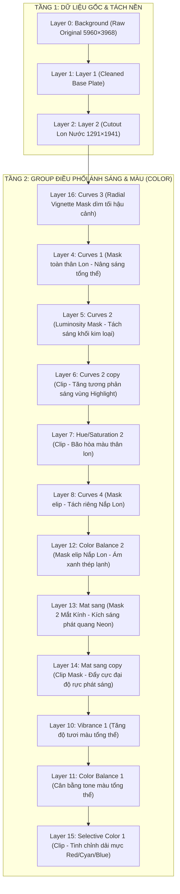

# 🔬 Phân Tích Chuyên Sâu Tệp Retouch Lon Nước (`2025-04-11 22-22-12 (B,R8,S4).tif`) & Kiến Trúc AI Tự Động Bóc Tách Layer Ánh Sáng / Màu Sắc

Tài liệu này tổng hợp toàn bộ kết quả bóc tách dữ liệu gốc từ tệp **1.1 GB** (`D:\Test psd\2025-04-11 22-22-12 (B,R8,S4).tif`), phân tích luồng tư duy retouching chuyên nghiệp và thiết kế giải pháp AI để tự động hóa quy trình này trên bất kỳ bức ảnh sản phẩm nào.

---

## 1. Đối Chiếu Thực Tế: BEFORE vs AFTER

Bức ảnh ghi lại sản phẩm đồ chơi/sưu tầm **Lon nước Kamen Rider Build — "Rabbit Tank Sparkling"** chụp trong điều kiện phòng bình thường:


### Nhận xét sự biến đổi:
1. **Ảnh Gốc (BEFORE):**
   - Chụp trên giường ngủ với ánh sáng phòng yếu, độ tương phản thấp.
   - Thân lon kim loại mạ chrome bị xỉn màu, bám bóng phản chiếu đen kịt.
   - **Hai thấu kính mắt (Kính xanh Tank & Kính hồng Rabbit):** Tối om, đục ngầu, hoàn toàn không có ánh sáng phát quang bên trong.
   - Hậu cảnh (ba lô đen, ví rằn ri, ga giường họa tiết khủng long) tranh chấp sự chú ý với sản phẩm.
2. **Ảnh Sau Retouch (AFTER):**
   - **Thấu kính mắt phát sáng rực rỡ (Inner Neon Glow):** Kính bên trái rực màu xanh điện tử, kính bên phải bừng sáng màu hồng neon cực mạnh.
   - **Chi tiết kim loại bóng loáng:** Các gờ chrome ở nắp lon và viền thân phản quang ánh thép sáng rực.
   - **Tập trung thị giác:** Hậu cảnh xung quanh được dìm tối mềm mại, biến một bức ảnh chụp phòng bình thường thành ảnh poster quảng cáo thương mại.

---

## 2. Giải Phẫu Cấu Trúc 18 Layer & Luồng Logic Kỹ Thuật

Qua việc phân tích trực tiếp khối dữ liệu `Tag 37724 (ImageSourceData)` bên trong file TIFF, toàn bộ cây layer gồm **18 layer/group** được bố trí theo đúng trật tự từ dưới lên trên:



---

## 3. Khảo Sát Chi Tiết Các Mặt Nạ (Layer Masks) Trọng Yếu

Các mặt nạ trích xuất trực tiếp từ file thể hiện rõ ý đồ chia tách ánh sáng:


### Phân tích 4 mặt nạ chủ chốt trong hình trên:
1. **Mask 04 (`Curves 1`):** Mặt nạ trùm trọn vẹn toàn bộ thân lon nước. Retoucher dùng nó để tăng sáng riêng phần sản phẩm mà không làm sáng ga giường hay ba lô.
2. **Mask 08 (`Curves 4`):** Mặt nạ hình elip chính xác ở **Nắp Lon**. Nắp lon bằng kim loại mờ cần đường cong tương phản khác hẳn thân lon bóng.
3. **Mask 13 (`Mat sang` - "Mặt sáng"):** Mặt nạ 2 con mắt thấu kính. Đây là "linh hồn" của tác phẩm — retoucher tách riêng 2 con mắt và dùng đường cong Curve bẻ gãy điểm sáng, biến nhựa đục thành nguồn đèn phát sáng.
4. **Mask 16 (`Curves 3`):** Mặt nạ chuyển sắc tròn mềm mại (Radial Inverse Gradient). Tâm lon màu đen (giữ nguyên độ sáng), xung quanh màu trắng (chịu tác động giảm sáng), tạo hiệu ứng spotlight tập trung.


* **Mask 05 (`Curves 2`):** Là một **Luminosity Mask (Mặt nạ độ sáng)** lấy từ độ tương phản thực tế của lon để bảo vệ các vùng bóng đổ sâu, chỉ nâng các gờ kim loại sáng.
* **Mask 12 (`Color Balance 2`):** Áp riêng lên nắp lon để khử sắc ám vàng của đèn phòng, bù sắc Cyan/Blue tạo cảm giác thép lạnh cao cấp.

---

## 4. Kiến Trúc Phát Triển Hệ Thống AI Tự Động Hóa Quy Trình Này

Để tạo ra một AI có khả năng: **"Đưa ảnh gốc bất kỳ vào $\rightarrow$ Tự hiểu logic layer từ ánh sáng tới màu sắc $\rightarrow$ Tự bóc tách thành các layer có thể chỉnh sửa như file mẫu"**, kiến trúc cần 4 khối xử lý (Pipeline):

```
                   [ ẢNH SẢN PHẨM GỐC ĐẦU VÀO ]
                                 │
     ┌───────────────────────────┴───────────────────────────┐
     ▼                                                       ▼
[ KHỐI 1: BÓC TÁCH CẤU TRÚC ]                 [ KHỐI 2: TÁCH BẢN THỂ ÁNH SÁNG ]
(Semantic Part Segmentation)                  (Intrinsic Image Decomposition)
• Cutout sản phẩm toàn thể (SAM 2)            • Albedo (Màu gốc vật liệu)
• Emissive / Glow Parts (Mắt, đèn LED)         • Shading (Khối sáng tối)
• Specular / Metallic Parts (Chrome, nắp)     • Specular Reflection (Độ phản quang)
• Background Mask (Hậu cảnh)                             │
     │                                                   │
     └───────────────────────────┬───────────────────────┘
                                 ▼
               [ KHỐI 3: SUY LUẬN THÔNG SỐ ĐIỀU CHỈNH ]
               (Parametric Lighting & Color Reasoning)
               • Tính toán độ tương phản spotlight (Vignette Curve)
               • Tính toán đường cong đẩy sáng phát quang (Glow Curves)
               • Tính toán độ lệch màu kim loại (Color Balance / Selective Color)
                                 │
                                 ▼
               [ KHỐI 4: ĐÓNG GÓI CÂY LAYER PHOTOSHOP ]
               (Non-destructive PSD/TIF Layer Builder)
               • Tạo Layer Cutout trong suốt (Layer 2)
               • Tạo các Adjustment Layers sống (Curves, Color Balance...)
               • Gắn Masks và Clipping Masks tương ứng
               • Xuất file .PSD / .TIF 16-bit chuẩn công nghiệp
```

### Chi tiết triển khai từng khối công nghệ:

#### Khối 1: Semantic Part Segmentation (Bóc tách bộ phận chi tiết)
* **Công nghệ:** **SAM 2 (Segment Anything 2)** kết hợp với **Grounding DINO** hoặc **YOLO-World**.
* **Nhiệm vụ:**
  - Nhận diện toàn bộ sản phẩm $\rightarrow$ sinh ra `Layer 2 (Cutout)`.
  - Phân tích văn bản/nhãn đặc thù: Dùng prompt `"lights, LEDs, visor, eyes, glowing parts"` để bắt đúng vùng kính phát sáng $\rightarrow$ sinh ra Mask cho `Mat sang`.
  - Phân tích nắp/viền kim loại: Dùng prompt `"metal lid, chrome rim"` $\rightarrow$ sinh ra Mask cho `Nắp lon`.

#### Khối 2: Intrinsic Image Decomposition (Phân tách Vật lý Ánh sáng)
* **Công nghệ:** Các mô hình phân tách vật lý như **IID-Net** hoặc **Inverse Rendering (Total3DUnderstanding)**.
* **Nhiệm vụ:**
  - Tự động tách ảnh thành 3 kênh vật lý:
    1. **Albedo:** Màu sơn gốc (không dính bóng).
    2. **Shading:** Đổ bóng không gian.
    3. **Specular:** Các điểm lóe sáng bóng bẩy trên bề mặt kim loại.
  - Từ kênh Shading & Specular, thuật toán tự động sinh ra **Luminosity Masks** (tương đương `Curves 2` trong file mẫu) mà không cần người dùng vẽ tay.

#### Khối 3: Parametric Lighting & Color Reasoning (Suy luận thông số Curves)
* **Công nghệ:** VLM (Vision-Language Model như GPT-4o / Claude 3.5 Sonnet / Gemini Vision) hoặc mạng nơ-ron học thông số đường cong (Deep Parametric Curves).
* **Nhiệm vụ:**
  - Xác định "ý đồ thẩm mỹ": Sản phẩm đang thiếu sáng chỗ nào? Thấu kính có cần giả lập ánh sáng phát quang neon không?
  - Tạo ra các điểm nút trên đồ thị Curves (VD: `Point(0,0)`, `Point(128, 180)`, `Point(255, 255)` để tăng sáng, hoặc hạ Midtone để tạo Vignette).
  - Xuất bảng thông số dạng số cho từng công cụ: Curves LUT, Color Balance values, Hue/Sat delta.

#### Khối 4: Đóng gói Layer PSD Sống (Non-Destructive PSD Generation)
* **Công nghệ:** `psd-tools` (Python) hoặc `ag-psd` (Node.js).
* **Nhiệm vụ:**
  - Không vẽ bẹp màu vào pixel mà tạo **Adjustment Layers chuẩn** (`curv`, `blnc`, `hue2`, `selc`).
  - Gắn kèm các mặt nạ 8-bit hoặc 16-bit và thiết lập các cờ `clipping = true`.
  - Kết quả xuất ra file `.PSD` người dùng mở bằng Photoshop thì mọi layer đều có thể double-click mở cửa sổ Properties chỉnh tiếp như file mẫu gốc.

---

## 5. Kết Luận

File tệp `2025-04-11 22-22-12 (B,R8,S4).tif` là một ví dụ mẫu mực về **quy trình retouching phi phá hủy (Non-destructive Retouching)**. Bằng cách kết hợp **Phân đoạn ngữ nghĩa bộ phận (Part Segmentation)** và **Phân tách ánh sáng vật lý (Intrinsic Lighting)**, việc tự động hóa để tái tạo lại luồng layer này trên mọi bức ảnh sản phẩm mới là hoàn toàn khả thi về mặt kỹ thuật.
